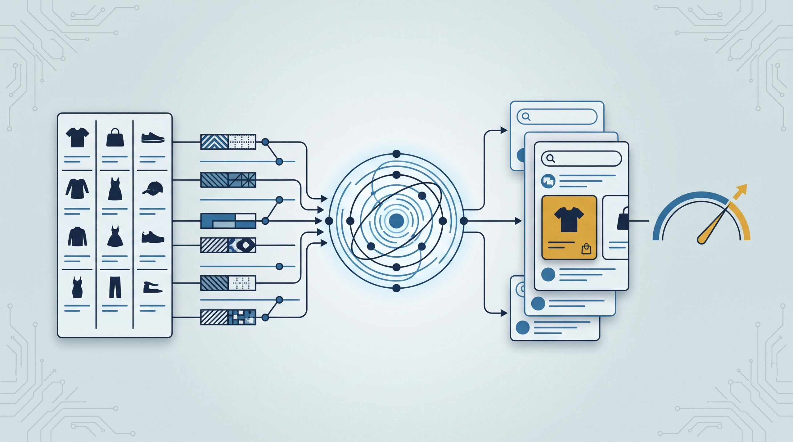

<figure class="figure">
  
</figure>

This page is the map of that work, and where to start.

## What is AI commerce?

AI commerce is the discipline of being the product an AI assistant finds, trusts, and recommends, and of being buyable the moment the shopper acts on that recommendation. It sits on top of ecommerce SEO, but it is not the same job. Classic ecommerce SEO wins a ranked link on a results page a human scrolls. AI commerce wins a place inside the answer an assistant hands back, where the shopper is given a short list of options that something already vetted for them. The surfaces are new, the buyer behavior is new, and the data the engines read is not the page your customer sees.

Two jobs live inside it. The first is getting found: appearing in the AI shopping answer at all. The second is getting bought: being verifiable and buyable so the recommendation turns into an order rather than a dead end. Most brands are losing the first job without knowing it, and have never measured the second.

## Why is my catalog invisible in AI shopping?

Because the engines are not reading your store the way you think. Google's AI shopping surfaces, AI Mode, AI Overviews, and Gemini, ground their product answers in the Shopping Graph, a product-data layer that Google has described as holding tens of billions of listings. Google's AI does not keep a separate understanding of your store. It reads the Shopping Graph, and your Google Merchant Center feed is the direct input to it. If your feed is incomplete, stale, disapproved, or missing identifiers, your products sit in the graph in a form the AI cannot represent accurately, so it reaches for a competitor it can.

This is the commerce version of a problem the site covers in [the source-of-truth gap](/blog/the-source-of-truth-gap/) and in [your JavaScript site is invisible to AI crawlers](/blog/your-javascript-site-is-invisible-to-ai-crawlers/): the facts a machine needs are present for human eyes and absent for the machine. A price painted in by a script, a stock status in a late-loading widget, a delivery date inside an image, all of it is invisible to the surface that is deciding whether to name you.

## Get found: how AI shopping surfaces choose products

Getting found runs on four layers, and they stack.

The feed is the foundation. A healthy, approved Merchant Center feed with GTINs, MPNs, and brand, accurate real-time price and availability, specific descriptive titles, the correct Google product category, and clean images is the baseline that lets any Google AI surface represent your products. Google has also added attributes aimed squarely at AI surfaces, including product highlights, structured product details, richer variant data, product-level questions and answers, linked documents such as manuals, and a popularity rank. These are not decorative. They are how the engine answers a specific shopper question with your product instead of summarizing past you. The deeper mechanics of [getting your product data agent-readable](/blog/agent-readable-product-feeds/) are their own build.

The page has to match the feed. Product schema on the page, name, brand, price, availability, GTIN, ratings, has to agree with the feed and with what the shopper sees, because Google cross-checks them and treats a mismatch as a reason to doubt you. [Review schema](/blog/review-schema-trust-signal/) and a [GTIN that connects your marketplace reviews](/blog/gtin-connects-your-marketplace-reviews/) to your product are part of the same move: they let the trust signals you already earned count where the engine reads.

The answer-first page wins the lift. When the surface quotes a page rather than the feed, it lifts the clearest, most direct answer it can find, which is why [answer-first product and category pages](/blog/answer-first-product-and-category-pages/) beat pages that bury the fact under brand preamble, and why [grid-first category pages are losing](/blog/grid-first-category-pages-are-losing/) the extractable answer.

Off-site corroboration decides ties. AI answers lean on the places the models trust, reviews, third-party mentions, and the wider web agreeing with you. Being the brand the assistant names is an authority problem as much as a feed problem, which is the whole argument of [why your brand is not in the AI answer](/blog/why-your-brand-is-not-in-the-ai-answer/).

## Get bought: what happens when the shopper acts

For a while it looked like the purchase itself would move into the assistant. It mostly has not. OpenAI launched Instant Checkout in late 2025 and retired it in 2026, and the industry pattern settled into discover in AI, buy on your own site. Agentic checkout has not died, it has moved and is still consolidating, through Google's commerce protocol and Perplexity's buy feature, so the rails are real but not yet settled.

That makes the get-bought job clear rather than speculative. The shopper discovers you in the answer and lands on your store to buy, so the handoff has to hold: the price the agent read has to be the price on the page, the item it recommended has to be in stock, the delivery date has to be real, and the return terms have to be clear. [An AI agent will not recommend what it cannot verify](/blog/ai-agents-wont-recommend-what-they-cant-verify/), and [whether an AI agent can actually buy from you](/blog/can-an-ai-agent-buy-from-you/) comes down to whether those facts are exposed and consistent. The delivery promise is the sharpest example: the same [date a human needs to trust](/blog/shoppers-need-a-date-they-can-trust/) is the field an agent needs to verify, so solving it once serves both. And because the first AI-driven order is often with a brand the shopper did not know, keeping that customer is its own job, which is why you [let the marketplace win the first sale and own the second](/blog/marketplace-first-order-own-the-repeat/).

## How do you prove AI commerce is working?

This is the layer that separates real AI-commerce work from content theater, and it is the reason to trust any of it. AI-referred revenue is small today, tracked late, and easy to over-credit, because a shopper the assistant named may well have bought you anyway. If you read the attributed number in a dashboard, you will congratulate a channel for demand it only witnessed, the same failure that makes [platform ROAS grading its own homework](/blog/platform-roas-is-grading-its-own-homework/) so expensive.

The honest read is a controlled one. Track presence and citation share per engine as the leading indicator, whether you are named in the answer and whether that share is rising against competitors, not sessions. Then prove the revenue with [a geo holdout](/blog/how-to-run-a-geo-holdout-test/) or a lift test, and manage to [the incremental number a CFO trusts](/blog/incremental-roas-the-number-a-cfo-trusts/) rather than the gross. Measurement is not a separate service bolted on at the end. It is what tells you which of the get-found and get-bought moves actually moved money, so you fund the ones that did.

## Who does this work?

Lindsey Sobrinski helps ecommerce brands get found and get bought in AI, and proves it with incrementality. The combination is the point. Plenty of people will optimize content for AI search, and plenty will run a measurement test, but AI commerce needs both in one hand: the catalog, feed, and structured-data work that gets you into the answer, and the controlled measurement that tells you whether being there paid. The background is fifteen-plus years across performance marketing, SEO and AEO and GEO, lifecycle, and conversion, on retail, DTC, and B2B, including a national bridal retailer and a nine-figure retail brand. See the [about page](/about/) for the full record, or [work with me](/fractional/) to scope an engagement.

## Where to start

If your catalog is the priority, start with whether an AI surface can read and verify it, then fix the feed and the page together. If getting named is the priority, start with the authority and entity work. Either way, stand up the measurement first, so you can tell what worked.

The AI-commerce cluster, in reading order:

- [Why your brand is not in the AI answer](/blog/why-your-brand-is-not-in-the-ai-answer/), the authority magnet that feeds everything below.
- [An AI agent will not recommend what it cannot verify](/blog/ai-agents-wont-recommend-what-they-cant-verify/), the four fields an agent checks before it names you.
- [Agent-readable product feeds](/blog/agent-readable-product-feeds/), getting the catalog and feed ready for AI shopping.
- [Can an AI agent buy from you?](/blog/can-an-ai-agent-buy-from-you/), what has to hold at checkout.
- [Shoppers do not need free shipping, they need a date they can trust](/blog/shoppers-need-a-date-they-can-trust/), the delivery promise a human and an agent both read.
- [Your best reviews live on a marketplace, a GTIN tells AI they are yours](/blog/gtin-connects-your-marketplace-reviews/), connecting earned trust to your product.
- [Review schema as a trust signal](/blog/review-schema-trust-signal/), exposing ratings where the engine reads.
- [Answer-first product and category pages](/blog/answer-first-product-and-category-pages/), winning the quoted line.
- [Let the marketplace win the first sale, own the second](/blog/marketplace-first-order-own-the-repeat/), keeping the AI-acquired customer.
- [How to run a geo holdout test](/blog/how-to-run-a-geo-holdout-test/), the proof layer for all of it.

This page sits under the [SEO, AEO, and GEO lane](/seo-aeo-geo/) and alongside the [ecommerce SEO hub](/seo-aeo-geo/ecommerce-seo/).

## Sources

- Google Search Central and Merchant Center documentation on the Shopping Graph and product structured data (feed attributes, merchant listings): [developers.google.com](https://developers.google.com/search/docs/appearance/structured-data/product)
- PPC Land, "8 Google Merchant Center attributes your feed needs for AI Mode," 2026 (product highlights, details, variants, Q and A, document links, popularity rank): [ppc.land](https://ppc.land/8-google-merchant-center-attributes-your-feed-needs-for-ai-mode/)
- Reporting on OpenAI retiring ChatGPT Instant Checkout in 2026 and the shift to "discover in AI, buy on site": [digitalapplied.com](https://www.digitalapplied.com/blog/ai-agentic-commerce-discover-in-ai-buy-on-site-2026)
